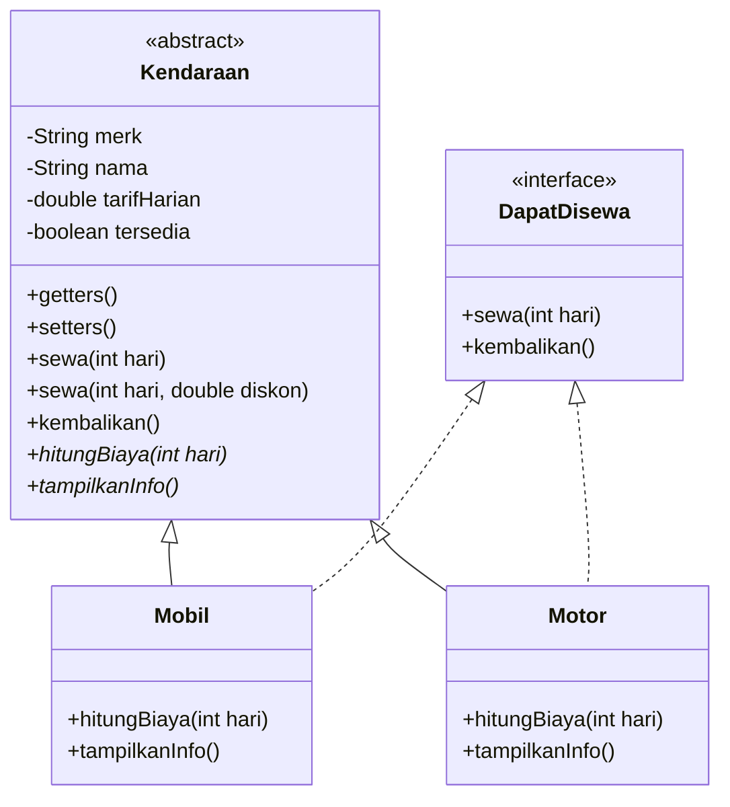

# Sistem Penyewaan Kendaraan Berbasis Java (OOP)

Praktik Lab Session 3B – Pemrograman Berorientasi Objek (PBO)

Program sederhana berbasis Java untuk mengelola penyewaan mobil dan motor dengan menerapkan konsep Object-Oriented Programming (OOP).

## Fitur

- Menampilkan daftar kendaraan yang tersedia
- Menyewa mobil dan motor
- Menghitung biaya sewa berdasarkan jumlah hari
- Memberikan diskon penyewaan (dalam persen)
- Mengembalikan kendaraan
- Menampilkan status ketersediaan kendaraan

## Struktur Project

```
LabSessionPBO3/
└── src/
    └── labsessionpbo3/
        ├── DapatDisewa.java   # Interface kontrak penyewaan
        ├── Kendaraan.java     # Abstract class (class induk)
        ├── Mobil.java         # Subclass Kendaraan
        ├── Motor.java         # Subclass Kendaraan
        └── Main.java          # Class utama untuk menjalankan program
```

| File | Jenis | Fungsi |
|------|-------|--------|
| `Kendaraan.java` | Abstract class | Class induk kendaraan |
| `Mobil.java` | Subclass | Mengelola data mobil |
| `Motor.java` | Subclass | Mengelola data motor |
| `DapatDisewa.java` | Interface | Kontrak penyewaan |
| `Main.java` | Main class | Menjalankan program |

## Diagram Kelas



## Penerapan Konsep OOP

| Konsep | Penerapan |
|--------|-----------|
| **Encapsulation** | Atribut `private` pada `Kendaraan` dengan getter dan setter |
| **Inheritance** | `Mobil` dan `Motor` mewarisi `Kendaraan` (`extends`, `super()`) |
| **Method Overriding** | `hitungBiaya()` dan `tampilkanInfo()` di `Mobil` dan `Motor` |
| **Method Overloading** | `sewa(int hari)` dan `sewa(int hari, double diskon)` |
| **Runtime Polymorphism** | Array `Kendaraan[]` yang berisi objek `Mobil` dan `Motor` |
| **Abstract Class** | `Kendaraan` dengan abstract method `hitungBiaya()` dan `tampilkanInfo()` |
| **Interface** | `DapatDisewa` diimplementasikan oleh `Mobil` dan `Motor` |

## Cara Menjalankan

### Menggunakan NetBeans
1. Buka project di NetBeans.
2. Pastikan kelima file berada dalam package `labsessionpbo3`.
3. Klik kanan `Main.java` lalu pilih **Run File** (atau tekan `Shift + F6`).

### Menggunakan Terminal
```bash
cd src
javac labsessionpbo3/*.java
java labsessionpbo3.Main
```

## Contoh Output

```
======================================
    SISTEM PENYEWAAN KENDARAAN
======================================

--- TRANSAKSI PENYEWAAN ---

1. Penyewaan Mobil:
Kendaraan : Avanza
Lama sewa : 2 hari
Biaya     : Rp700000.0
Diskon    : 0.0%
Total     : Rp700000.0
Status    : Berhasil disewa

2. Penyewaan Mobil dengan Diskon:
Kendaraan : Brio
Lama sewa : 1 hari
Biaya     : Rp300000.0
Diskon    : 10.0%
Total     : Rp270000.0
Status    : Berhasil disewa

--- PENGEMBALIAN KENDARAAN ---
Avanza berhasil dikembalikan.
Vario berhasil dikembalikan.

--- STATUS AKHIR KENDARAAN ---
Avanza : Tersedia
Brio : Sedang Disewa
Vario : Tersedia
NMAX : Sedang Disewa
```

## Data Kendaraan

| Jenis | Merk | Nama | Tarif per Hari |
|-------|------|------|----------------|
| Mobil | Toyota | Avanza | Rp350.000 |
| Mobil | Honda | Brio | Rp300.000 |
| Motor | Honda | Vario | Rp100.000 |
| Motor | Yamaha | NMAX | Rp150.000 |

## Teknologi

- Java (JDK 8 atau lebih baru)
- Apache NetBeans IDE

## Author

Praktik Lab Session 3B – PBO
